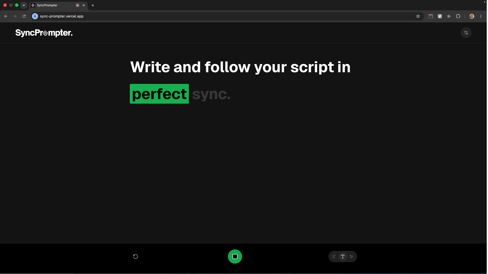
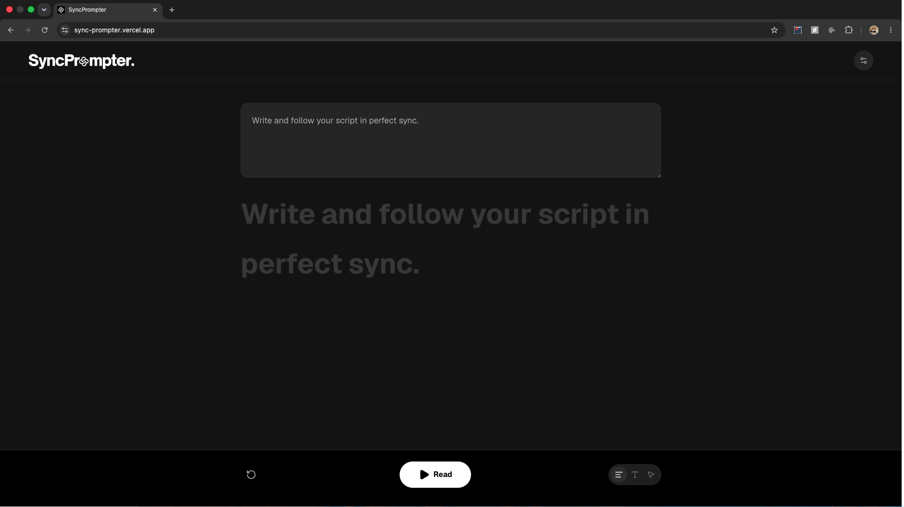
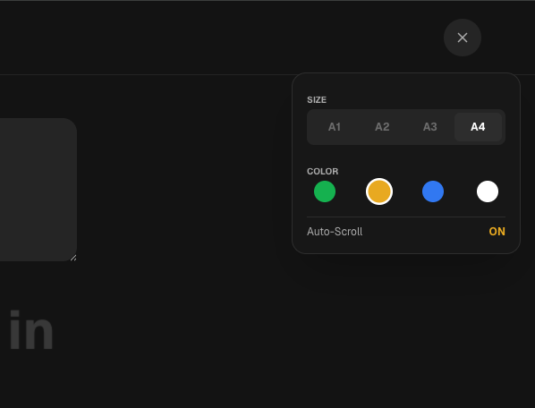

# SyncPrompter

An intelligent, voice-activated teleprompter that tracks your speech in real-time.

## 🚀 Live Demo

Try it live:
[https://sync-prompter.vercel.app](https://sync-prompter.vercel.app)

Experience seamless delivery—paste your script and start reading.

---

## 📖 Overview

Traditional teleprompters force you to follow a machine. Speakers frequently find themselves "chasing" a fixed-speed scroll or manually adjusting their pace, leading to robotic delivery, missed cues, and high stress.

**SyncPrompter** reverses this dynamic: the machine follows you. 

Built for content creators, educators, and public speakers, SyncPrompter uses advanced real-time speech recognition and a custom synchronization engine. It listens to your voice and automatically advances the text only as you read it. Pause for effect, take a breath, or ad-lib—SyncPrompter waits for you.

---

## ✨ Features

* **Real-time Voice Tracking:** Highlights the word you are reading as the browser's speech recognizer reports your speech.
* **Anchor-Based Matching:** Keeps your position in the script as you speak. Matching tolerates small differences in words, within fixed thresholds. See [Matching Rules](#-matching-rules) for the exact limits.
* **Smart Auto-Scroll:** Debounced, smooth scrolling keeps the active word centred on screen.
* **Click-to-Jump:** Click any word in the script to move the tracker there.
* **Number Matching:** Matches digits (e.g., "13") and spoken number forms ("thirteen", "one hundred", "twenty twenty six"). The mapping is fixed rather than learned from your speech. See the Number Forms part of [Matching Rules](#-matching-rules).
* **Dynamic Customization:** Change the text size and the accent colour on the fly.
* **Local Persistence:** Your script, text size and accent colour are saved in this browser's local storage. Auto-scroll and display mode are not saved.

---

## 🛠 How It Works

1. **Input:** Land on the page and paste your script into the intuitive editor.
2. **Calibrate:** Use the settings menu to change the text size and accent colour.
3. **Initiate:** Click "Read" to start listening. The browser asks for microphone permission if it has not been granted.
4. **Perform:** Start speaking. The interface transitions into focus mode, tracking your voice and auto-scrolling the text smoothly.

---

## 💻 Tech Stack

**Frontend**
* Next.js 16 (App Router)
* TypeScript
* Tailwind CSS
* Lucide React

**AI & Speech**
* Web Speech API (`SpeechRecognition` / `webkitSpeechRecognition`)
* Fast Levenshtein (Fuzzy Matching Engine)

**Deployment**
* Vercel

---

## 📸 Screenshots

### Home Page

### Core Feature

### Settings & Customization

---

## 🎯 Use Cases

* **Content Creators:** Record YouTube videos with perfect eye contact and a natural pace, drastically reducing retakes.
* **Keynote Speakers:** Present confidently on stage using a digital podium guide that accommodates natural pauses and audience interaction.
* **Educators:** Record online lectures or conduct live classes smoothly without managing a scrolling teleprompter.
* **Accessibility:** Assist individuals practicing reading fluency with real-time visual feedback and pacing support.

---

## 🏗 Architecture (Simple)

The matching engine runs in the browser, but speech recognition is not on-device. The browser's speech service converts your audio to text, so the audio is sent to that service. The page also loads a third-party feedback widget from `tally.so` on every page, and the Feedback button opens a Tally form.

1. **Audio Capture:** The browser's speech recognition API captures microphone audio while you read.
2. **Transcription:** The browser's speech service returns interim and final text results.
3. **Synchronization Engine:** Matching runs in the page. Each result is matched only for the words that are new since the previous result, against a sliding window of the script.
4. **UI Updates:** The page highlights the active word and scrolls it into view. Every word is rendered; the script is not virtualized.

---

## 🎚 Matching Rules

These are the exact rules in `app/lib/matcher.ts` and `app/lib/numberWords.ts`. Change them there and here together.

**Word comparison**
* Words are compared in lower case with every character other than a–z and 0–9 removed. Punctuation and hyphens are removed, so "e-mail" matches "email". Accented letters are removed too, so "café" is compared as "caf". Tokens with no letters or digits (such as a spaced em dash) are ignored.
* Similarity = 1 − (edit distance ÷ length of the longer word), on the compared forms.

**Thresholds**

The threshold depends on the length of the script word.

| Script word length | Required similarity | What a spoken word needs |
|---|---|---|
| 4 letters or fewer | ≥ 0.95 | Exact match |
| 5 letters or more | ≥ 0.82 | No more edits than the table below allows |

The allowance uses the length of the longer of the two words:

| Longer word | Edits allowed |
|---|---|
| 5 letters | 0 |
| 6–11 letters | 1 |
| 12–16 letters | 2 |
| 17–22 letters | 3 |

So a 5-letter script word takes one edit only against a 6-letter spoken word: "house" matches "houses", but "horse" does not match "house".

**Skipped and jumped words**
* A short script word (4 letters or fewer) that you leave out is skipped. Skipping one short word is always allowed. Skipping more needs the word the tracker lands on to be unique in the words it searches. The skip reaches up to 8 positions ahead of the current word.
* A long script word (5 letters or more) that you leave out is not skipped over, so the tracker can stall on it until the word itself is spoken or a later word is reached by the jump rule.
* A spoken word of 5 letters or more can jump ahead 2 to 8 words to a script word that is unique in the words it searches and has similarity above 0.90.
* The filler sounds "um", "uh", "erm", "hmm" and "mhm" in the speech are ignored.

**Number Forms**
* Digits and spoken words are compared in the same form. "100" matches "one hundred", "21" matches "twenty one", "1,000" matches "one thousand", "3.5" matches "three point five", "2026" matches "twenty twenty six", and "21st" matches "twenty first".
* Years from 1100 to 2099 that do not end in "00" are spoken in pairs ("twenty twenty six"; "twenty oh five"). Other numbers use "hundred" and "thousand".
* Numbers up to 999,999 are matched as words. Ordinals up to 99th are matched as words. Larger numbers match digits only.
* The mapping is fixed. Forms it does not list, such as "one hundred and five" or "nineteen hundred", are not matched.

---

## 🗺 Roadmap

**Completed**
* Core real-time voice synchronization
* Anchor-based matching and jump prevention
* Accent colour themes and local persistence

**In Progress**
* Deepgram WebSocket integration for multi-language support and enhanced accuracy
* Save/Load scripts via Supabase

**Future Ideas**
* Mobile app companion (remote control)
* Eye-tracking integration for extreme accuracy
* Export transcripts and timing data

---

## ✅ Verification Status

This section lists only what the focused test run for this change checked. Anything not listed under "Built and tested" is not claimed.

**Built and tested** (jsdom tests with a fake Web Speech recognizer, not a live microphone)
* Matching: each recognizer result is matched only for the words that are new since the previous result. Re-sent results do not advance the tracker. A revised or shorter hypothesis is aligned with the words already reported, and only the words after its last aligned word are matched. A revision that changes the case or punctuation of reported words does not replay them.
* Matching: skipped short words do not freeze the tracker. A spaced em dash does not stall it. Hyphens are removed, so "e-mail" matches "email". The number forms in [Matching Rules](#-matching-rules) match word by word.
* Click-to-jump: clicking a word moves the tracker to it. Clicking does not replay speech that was not matched.
* Speech lifecycle: `not-allowed`, `service-not-allowed`, `audio-capture` and `network` stop listening with a specific message and are not retried. Stop cancels a pending restart, and so does unmounting. A restart or a first `start()` that throws stops listening and shows an error. Listening is shown only once the session has started. Consecutive sessions that never start count toward a limit of five, after which listening stops with a message. The count is reset when recognized speech arrives or Read is pressed, not when a session starts.
* Wake lock: a lock that resolves after Stop is released (jsdom test with a mocked Wake Lock API).
* Read is enabled on a first visit with a script. Read is disabled with an explanation when speech recognition is missing.
* Saved state: storage that cannot be read or written does not crash the page. Saved values of the wrong type fall back to defaults. An empty script is kept. Saved state survives React StrictMode.
* A render failure shows a recovery message instead of a blank page.

**Regression tests**
The focused run for this change covered `tests/matcher.test.ts`, `tests/voice-reader.test.tsx`, `tests/error-boundary.test.tsx` and `tests/unreported-words.test.ts`: 74 tests, all passing. `tests/saved-settings.test.ts` was not part of that run.
* `tests/voice-reader.test.tsx`: the page, driven through a fake Web Speech recognizer.
* `tests/matcher.test.ts`: the matcher and number forms, including hyphenated words.
* `tests/unreported-words.test.ts`: the revision alignment, including a seeded property test over 200 sessions of random revisions.
* `tests/error-boundary.test.tsx`: the recovery message.

**Not verified**
* `npm run lint`, `npx tsc --noEmit` and `npm run build` were not run for this change.
* `npm audit` was not re-run for this change, so no advisory counts are stated. `next` is pinned to 16.3.8 in `package.json`; whether that clears the advisories reported for `next@16.1.0` is not verified here.
* Live recognition with a microphone. No live speech session was run.
* Browsers other than Chrome. The Read button was not checked in Chrome or on a production build.
* "Zero-latency" tracking. Latency was not measured.
* The network traffic from speech recognition. The privacy statement follows the Web Speech API's documented behaviour; traffic was not captured.
* Wake lock behaviour.
* The live Vercel deployment. These changes have not been deployed.

**Known limits**
* A skipped long script word stalls the tracker until a later long word matches. See [Matching Rules](#-matching-rules).
* An edit that cannot be saved (storage is full or blocked) is kept only until the page is reloaded.
* When the recognizer revises a hypothesis, words it places before the last reported word are not matched.

**Not built**
* Sentence-level virtualization, typography controls, and contrast controls beyond the accent colour. The Deepgram and Supabase roadmap items are also not built.

---

## 📄 License

Distributed under the MIT License. See `LICENSE` for more information.
